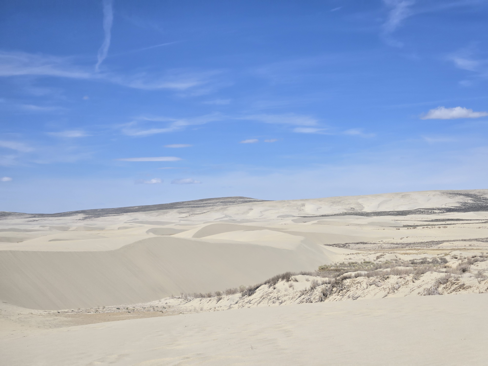

---
layout: default
title: Field Work | Tyler Roscoe
---


<link rel="stylesheet" href="{{ '/assets/css/custom.css' | relative_url }}">

  <section class="hero">
    
Geology · Field Experience

    <h1>Field Work</h1>

    

      As a planetary geologist, the best way to understand other worlds is to have a good understanding of the planet I live on. With that, field work is a core part of my learning. Much of my work encompasses Earth analog studies, where I examine parts of the Earth an analogy to study other worlds. 
    

  </section>

  <section class="portfolio-section">
    <h2>Field Experience</h2>

    

      Fieldwork provides an opportunity to observe
      geological processes directly and connect
      field observations with broader geological
      questions.
    

  </section>

  <section class="portfolio-section">
    <h2>Current Field Site: Killpecker Dunes, Wyoming</h2>

    

      For my current research for my Master's thesis, I study the Killpecker Dune field in western Wyoming. You can find more details on the goals of this project on my research page. At this site  I will employ a variety of geophysical techniques, which will include: ground penetrating radar (GPR), electrical resistivity tomography (ERT), and electromagnetic induction (EMI). In addition I also plan to take sediment and ice cores, as well as build a deep dataset of LiDAR point clouds. 
  
    

    

    

      Field site in Wyoming at the Killpecker Dune Field.
    

  </section>

  <section class="portfolio-section">
    <h2>Future Field Experiences</h2>

    

      Additional field experiences, geological
      observations, and photographs will be added
      as my academic and research experience develops.
    

  </section>

