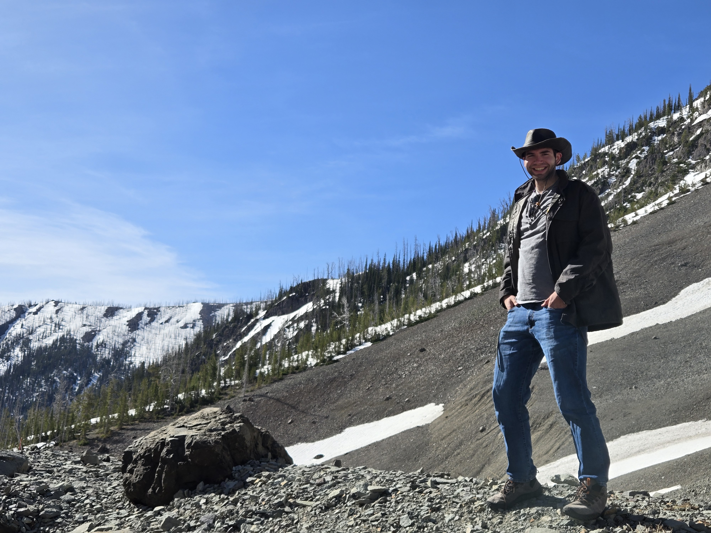


<link rel="stylesheet" href="{{ '/assets/css/custom.css' | relative_url }}">

  <section class="portfolio-section">
    <h2>Academic Background</h2>

    

      <strong>Master of Science Student in Geology</strong>
       
      University of Wyoming
       
      Department of Geology & Geophysics
       
       
      <strong>Research Advisor:</strong>
      Dr. Robert Mahon
       
      <Strong> Rob's Website </strong>
      https://www.bedform.org/ 
      
    

  </section>

  <section class="hero">
    
Geology · Planetary Science · Research

    <h1>Tyler Roscoe</h1>

    

      Exploring terrestrial and icy worlds, their surface processes, resources, and habitability.
       
    

    <a class="portfolio-button" href="#research">Explore My Research</a>
    <a class="portfolio-button" href="RoscoeCV.pdf">View My CV</a>
  </section>

  <section class="portfolio-section" id="research">
    <h2>About Me</h2>

    

    I am a geologist at my core, but I aim to be a multidisciplinary planetary scientist. As undergraduate in addition to geology I studied both physics, and astronomy. With my research I bring in a broad mindset. You can check out my CV for a list of my multidisciplinary experiences. At the moment most of the questions I am trying to answer involve the planet Mars. 
    

    

      
Terrestrial Worlds: Venus, Earth, Mars, Titan

      
Icy Worlds and Polar Regions

      
Surface Processes

      
Applied Geophysics

      
Applied Geochemistry

      
Resources & Habitability

    

  </section>

 <section class="portfolio-section" id="field-work">
    <h2>My View on Studying Planets</h2>

    

      I think field experiences are an important part of understanding
      broader planetary science questions. Before one can think of other worlds, they should start with their own. 
    

    

    

      At Yellowstone National Park (Field Course).
    

  </section>

  <section class="portfolio-section" id="cv">
    <h2>Curriculum Vitae & Resources</h2>

    

      Learn more about my academic background and the
      University of Wyoming Department of Geology & Geophysics.
    

    <a class="portfolio-button" href="RoscoeCV.pdf">
      Download My CV
    </a>

    <a class="portfolio-button"
       href="https://www.uwyo.edu/geolgeophys/"
       target="_blank"
       rel="noopener noreferrer">
      UW Geology & Geophysics
    </a>
  </section>

  <section class="portfolio-section" id="contact">
    <h2>Get in Touch</h2>
    
    

      

        Interested in my research or want to connect?
        Feel free to reach out.
      

      <a href="mailto:troscoe@uwyo.edu">
        troscoe@uwyo.edu
      </a>
      

      <strong> LinkedIn </strong>
       
      https://www.linkedin.com/in/tyler-roscoe/
      

    

  </section>

