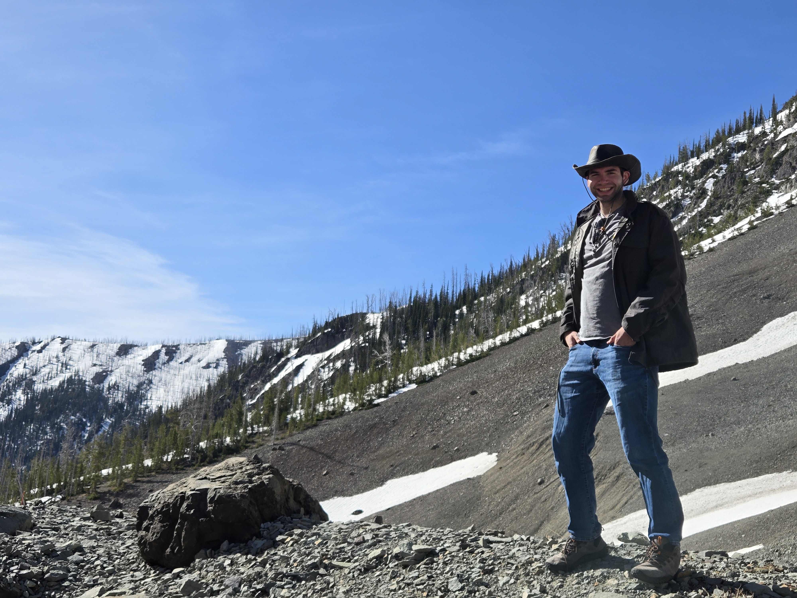


<link rel="stylesheet" href="{{ '/assets/css/custom.css' | relative_url }}">

  <section class="hero">
    
Geology · Planetary Science · Research

    <h1>Tyler Roscoe</h1>

    

      MS Student · Department of Geology & Geophysics
       
      University of Wyoming
    

    

      Exploring terrestrial and icy worlds through the study of
      planetary surface processes, resources, and habitability.
    

    <a class="portfolio-button" href="#research">Explore My Research</a>
    <a class="portfolio-button" href="RoscoeCV.pdf">View My CV</a>
  </section>

  <section class="portfolio-section" id="research">
    <h2>Research Interests</h2>

    

      I am a Master's student in Geology at the University of Wyoming,
      working with Dr. Robert Mahon. My interests center on terrestrial
      and icy worlds throughout our solar system, with a focus on the
      processes that shape planetary surfaces and influence the
      availability of resources and potential habitability.
    

    

      
Planetary Geology

      
Icy Worlds

      
Surface Processes

      
Planetary Resources

      
Habitability

    

  </section>

  <section class="portfolio-section">
    <h2>Academic Background</h2>

    

      <strong>Master of Science Student in Geology</strong>
       
      University of Wyoming
       
      Department of Geology & Geophysics
       
       
      <strong>Research Advisor:</strong>
      Dr. Robert Mahon
    

  </section>

 <section class="portfolio-section" id="field-work">
    <h2>Field Work</h2>

    

      Field experiences are an important part of understanding
      Earth's geological processes and connecting observations
      in the field with broader planetary science questions.
    

    

    

      Fieldwork at Yellowstone National Park.
    

  </section>

  <section class="portfolio-section" id="cv">
    <h2>Curriculum Vitae & Resources</h2>

    

      Learn more about my academic background and the
      University of Wyoming Department of Geology & Geophysics.
    

    <a class="portfolio-button" href="RoscoeCV.pdf">
      Download My CV
    </a>

    <a class="portfolio-button"
       href="https://www.uwyo.edu/geolgeophys/"
       target="_blank"
       rel="noopener noreferrer">
      UW Geology & Geophysics
    </a>
  </section>

  <section class="portfolio-section" id="contact">
    <h2>Get in Touch</h2>
    
    

      

        Interested in my research or want to connect?
        Feel free to reach out.
      

      <a href="mailto:troscoe@uwyo.edu">
        troscoe@uwyo.edu
      </a>
    

  </section>

  <footer class="portfolio-footer">
    Tyler Roscoe · University of Wyoming
  </footer>

