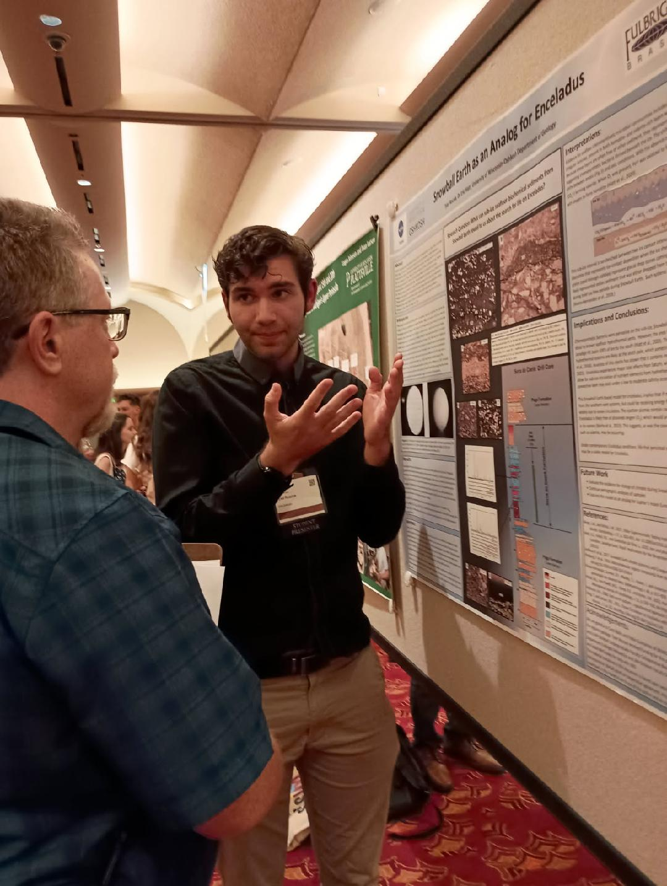

---
layout: default
title: Research | Tyler Roscoe
---



<link rel="stylesheet" href="{{ '/assets/css/custom.css' | relative_url }}">

  <section class="portfolio-section">
    <h2> Current Research Overview</h2>

    

      My work for my Master's Thesis is attempting the tackle problem of understanding contemporary Martian aeolian hydrodynamics with seasonal and perennial ice and snow (water and carbon dioxide). To do this we are studying an Earth analog system in the Killpecker Dune Field in western Wyoming. I will be studying snow and ice entrainment in this field to propose analogy to potentially the polar regions of Mars. On Earth I will employ near surface geophysics, LiDAR, and geochemical isotope techniques. I will then be comparing this Martian remote sensing data to the best of my ability. You can check out my field work page to see the site, and more details on my methods.
    

  </section>
  <section class="portfolio-section">
    <h2>Previous Work</h2>

    

      When I was an undergraduate student at the University of Wisconsin-Oshkosh. I studied the biogeochemical glaciomarine banded iron formations preserved in Brazil as an analog to build a model for potential habitability for chemosynthetic lifeforms on Saturn's moon Enceladus. We (myself, and my previous advisor Eric Hiatt) titled the project "Snowball Earth as an Analog for Enceladus". For this project we received funding from the NASA Wisconsin Space Grant Consortium. 
    

     

    

      Me presenting research at a Conference.
    

  </section>
  

  <section class="portfolio-section">
    <h2>Academic Affiliation</h2>

    

      <strong>University of Wyoming</strong>
       
      Department of Geology & Geophysics
       
      Master's Student in Geology
        
      <strong>Research Advisor:</strong>
      Dr. Robert Mahon
       
      <Strong> Rob's Website <strong>
      https://www.bedform.org/ 
      
    

  </section>

